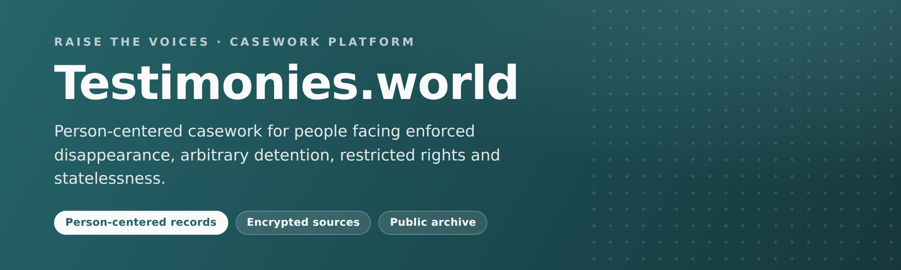
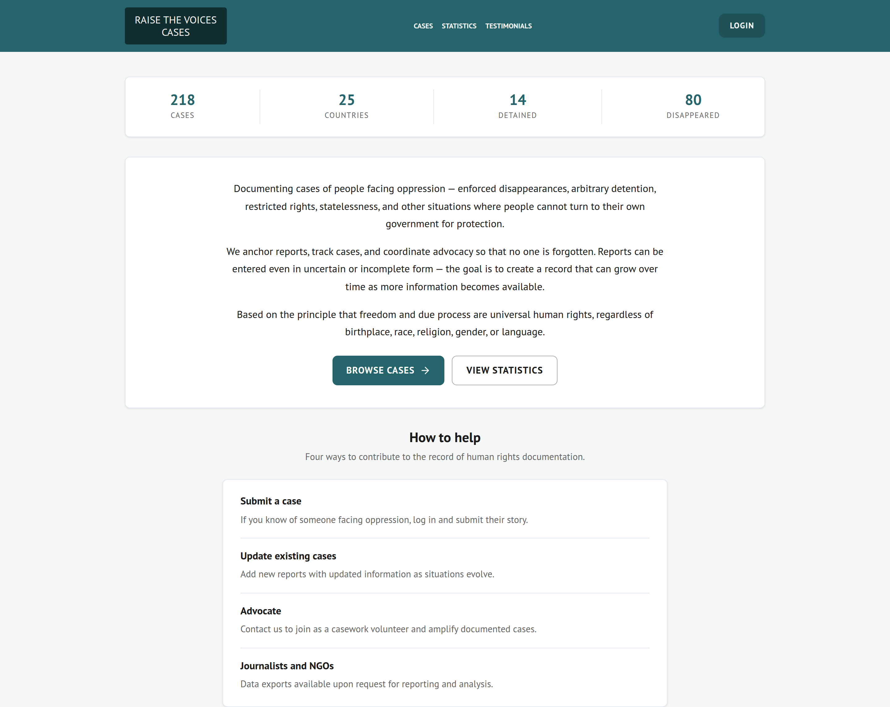
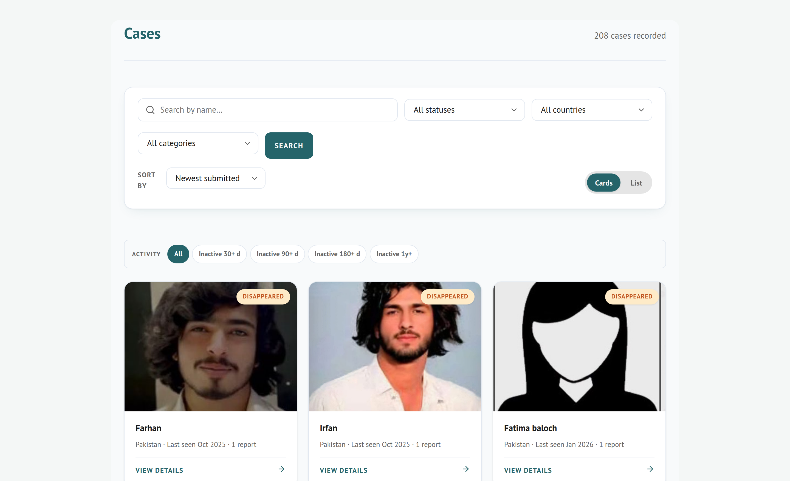
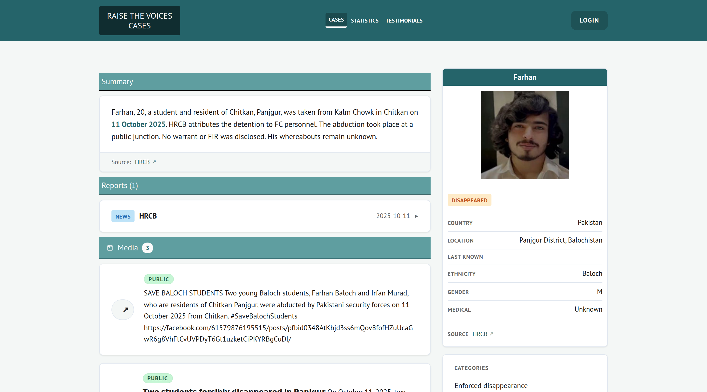
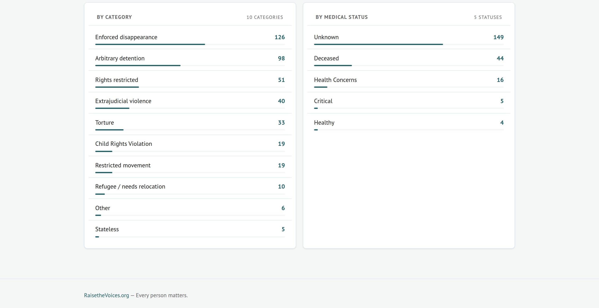
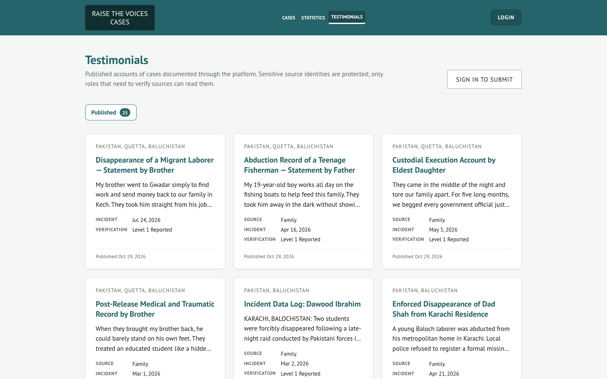
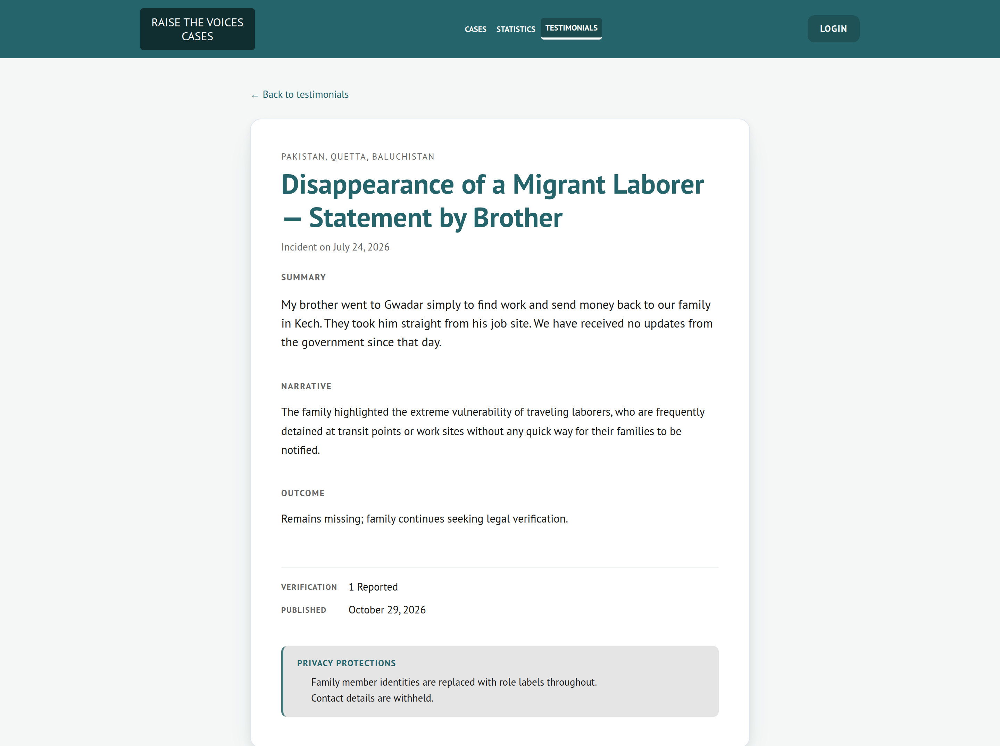

<div align="center">
  
</div>

<div align="center">

**[Live app](https://cases.raisethevoices.org/testimonies/)** · **[API schema](https://cases.raisethevoices.org/testimonies/api/schema/)** · **[Source](https://github.com/Raise-the-Voices/testimonies-world)** · **[Raise the Voices](https://raisethevoices.org/)**

[](https://github.com/Raise-the-Voices/testimonies-world/actions/workflows/ci.yml)
[](backend/requirements.txt)
[](frontend/package.json)
[](backend/requirements.txt)
[](backend/requirements.txt)
[](backend/testimonies/settings.py)
[](frontend/package.json)
[](openapi.yml)

</div>

<div align="center" style="background-color:#f4f7f6;border:1px solid #e2e8f0;padding:12px">

**218 cases recorded** &nbsp;·&nbsp; **208 published** &nbsp;·&nbsp; **25 countries** &nbsp;·&nbsp; **80 disappeared** &nbsp;·&nbsp; **14 detained** &nbsp;·&nbsp; **25 published testimonials**

</div>

---

<h2 style="color:#25646a">What this is</h2>

A record of one person's case, and the advocacy that followed it.

Cases of enforced disappearance, arbitrary detention, restricted rights and
statelessness are usually scattered: a news clipping, a court filing, a
family member's account, a lawyer's file. They get separated, and they get
forgotten. Testimonies.world keeps them attached to a single **Person** record
so the file grows over time instead of dissolving.

A case can be opened with three lines: a name, a country, a status. Everything
else can arrive later, as a dated **Report** attached to the same person, with
its own source and its own verification level. Nothing has to be complete on
day one.

The platform is operated by [Raise the Voices](https://raisethevoices.org/),
modeled on [shahit.biz](https://shahit.biz/), and built for human-rights
volunteers and caseworkers who are doing this alongside their day jobs.

<h2 style="color:#25646a">Who it is for</h2>

<table>
  <thead>
    <tr>
      <th style="background-color:#25646a;color:#fafafa;text-align:left">Role</th>
      <th style="background-color:#25646a;color:#fafafa;text-align:left">What they can do</th>
    </tr>
  </thead>
  <tbody>
    <tr><td><b>Public</b></td><td>Read published cases, public reports, published testimonials</td></tr>
    <tr><td><b>Volunteer</b></td><td>Open cases, add reports, attach media, draft testimonials</td></tr>
    <tr><td><b>Advocate</b></td><td>Casework records, contacts, restricted media, review and publish</td></tr>
    <tr><td><b>Admin</b></td><td>Sensitive media, audit logs, users, workflow configuration</td></tr>
  </tbody>
</table>

Roles are Django groups (`Volunteer`, `Advocate`) plus `is_staff` for admin.
They are enforced in three places that must agree: Django views, DRF
permission classes, and the frontend nav. The backend is the authority: the
UI hides what the API would refuse anyway.

<h2 style="color:#25646a">How a case moves</h2>

1. **Open the case.** A volunteer records the person: name, country, status,
   rough location. A precise location, medical notes and reporter identity
   are stored but never leave the server for anyone without the role.
2. **Attach reports.** Each report is one dated update with a narrative and
   a source type (`firsthand`, `secondhand`, `news`, `document`). A case
   accumulates one, then five, then forty.
3. **Work the case.** Casework records track what was actually done (a legal
   filing, a letter, media engagement, an investigation) and notify
   advocates when something changes.
4. **Publish a testimonial.** When a family wants the story told publicly, an
   advocate publishes it with the source identity encrypted and the location
   coarsened to whatever the family consented to.

<h2 style="color:#25646a">The screens</h2>

<p align="center"><b style="color:#25646a">Landing</b>: platform totals, and the four ways to contribute</p>
<p align="center"></p>

<p align="center"><b style="color:#25646a">Cases</b>: the searchable catalog of published cases</p>
<p align="center"></p>

<p align="center"><b style="color:#25646a">Case detail</b>: one person: summary, dated reports, media, and the record's own metadata</p>
<p align="center"></p>

<p align="center"><b style="color:#25646a">Statistics</b>: cases broken down by category and by medical condition</p>
<p align="center"></p>

<p align="center"><b style="color:#25646a">Testimonials</b>: the published archive</p>
<p align="center"></p>

<p align="center"><b style="color:#25646a">Published testimonial</b>: the public artifact, with the privacy rules stated on the page itself</p>
<p align="center"></p>

Every image above is a real screenshot of the running app. Regenerate them
with:

```bash
cd frontend
npm run dev -- --host 127.0.0.1 --port 3040   # dev server
node scripts/capture-readme-screenshots.mjs    # → docs/assets/*.png
node scripts/capture-readme-banner.mjs         # → docs/assets/banner.png
```

<h2 style="color:#25646a">What stays private</h2>

<div style="background-color:#f4f7f6;border-left:4px solid #25646a;padding:12px 16px">

**Field level**: `medical_notes` and `precise_location` (person);
`reporter_name`, `reporter_contact` and `precise_location` (report). Stripped
from the response entirely when the requester lacks the role.

**Internal**: `risk_level`, `risk_concerns`, `internal_notes`. Advocate and
staff only, because risk metadata can expose a source to retaliation.

**Media**: three tiers. `public` is anyone. `restricted` needs a session.
`sensitive` needs Advocate or staff, and the file is served through Django
behind an auth check, never off disk at a guessable URL. Public media is the
only tree nginx serves directly.

**Testimonials**: `source` and `precise_location` are Fernet-encrypted in the
database. They are read through separate endpoints
(`/api/testimonials/{id}/source/`, `/api/testimonials/{id}/precise_location/`)
that are not part of the public serializer, so the URL is the security
boundary, and every read writes an audit row.

**Audit**: every create, update, view, download and delete on a sensitive
record writes an `AuditLog` row with user, target, action and IP address.

</div>

<h2 style="color:#25646a">Run it locally</h2>

Two processes: Django on `:8040`, SvelteKit on `:3040`.

```bash
# Backend
cd backend
python3 -m venv .venv && .venv/bin/pip install -r requirements.txt
cp .env.example .env      # then fill in PG_* and SECRET_KEY
.venv/bin/python manage.py migrate
.venv/bin/python manage.py runserver 127.0.0.1:8040

# Frontend (second shell)
cd frontend
npm install
PUBLIC_BASE_PATH=/testimonies npm run dev -- --host 0.0.0.0 --port 3040
```

The Vite dev server proxies `/testimonies/api/*` to the backend, so the
backend has to be up first. `VITE_API_PROXY_TARGET` points the proxy somewhere
else. It defaults to the live backend, which is the normal day-to-day setup.

On a VM with systemd:

```bash
sudo systemctl start rtv-cases-backend rtv-cases-frontend
sudo journalctl -u rtv-cases-backend -f
```

<h2 style="color:#25646a">Repository layout</h2>

```
testimonies-world/
├── backend/
│   ├── cases/               Person, Report, Media, Source, CaseEvent,
│   │                        CaseUpdate, FamilyRelationship, AuditLog,
│   │                        CaseCategory, Testimonial, TestimonialTag
│   │   └── testimonials/    Encryption, permissions, export contract, workflow
│   ├── casework/            CaseworkRecord, Notification, UserPreference
│   ├── contacts/            Contact, always private
│   └── testimonies/         Settings, URLs, WSGI/ASGI, healthz
├── frontend/
│   ├── src/routes/          Pages (file-based routing)
│   ├── src/lib/             Components, stores, API client
│   ├── src/app.css          Design tokens, single source of truth
│   └── scripts/             OpenAPI codegen, README capture scripts
├── scripts/                 deploy.sh, backup_db.sh, nginx, systemd, docker
├── docs/assets/             README screenshots and banner
├── .github/workflows/       ci.yml, audit.yml, deploy.yml
├── openapi.yml              Generated from drf-spectacular, checked in
├── CLAUDE.md                Project facts for Claude Code
└── SYSTEM_RULES.md          Working agreement: diffs, branches, deploys
```

<h2 style="color:#25646a">Contributing</h2>

Read [`CLAUDE.md`](CLAUDE.md) and [`SYSTEM_RULES.md`](SYSTEM_RULES.md) first.
They are the project's working agreement and they are short.

- Work on a branch (`feat/`, `fix/`, `docs/`, `chore/`), never on `main`.
- Conventional commits, one logical change per commit.
- A PR to `main` needs green CI. Branch protection requires four checks:
  `backend`, `backend-pg`, `frontend-tests` and `frontend`.
- Run `npm run check` and `npm run test` before pushing; run the Django suite
  if you touched the backend.
- No credentials in the repo, in a diff, or in chat.

---

<h2 style="color:#25646a">Technical reference</h2>

Everything below is for people working on the code. The sections collapse.

<details>
<summary><b>Stack and versions</b></summary>

| Layer | Version | Notes |
|---|---|---|
| Python | 3.12.3 | Virtualenv at `backend/.venv` |
| Django | 6.0 | `testimonies.settings`, fail-closed `SECRET_KEY` / `ALLOWED_HOSTS` |
| DRF | 3.15.2 | `SessionAuthentication`, `IsAuthenticatedOrReadOnly` default |
| django-filter | 25.1 | `DjangoFilterBackend` + `SearchFilter` + `OrderingFilter` |
| django-allauth | 0.63.2 | Google OAuth in production |
| drf-spectacular | 0.28.0 | Generates `openapi.yml`; Swagger/Redoc are dev-only |
| cryptography | 50.0.1 | Fernet for testimonial source + precise location |
| gunicorn | 23.0.0 | 2 workers, journald via `StandardOutput=journal` |
| SvelteKit | 2.50.2 | `adapter-node` 5.5.4 |
| Svelte | 5.57.1 | Runes |
| Vite | 7.3.1 | Dev proxy `/testimonies/api` → backend |
| TypeScript | 5.9.3 | `strict` |
| Vitest | 5.0.0 | 116 unit tests across 7 files |
| Playwright | 1.63.0 | 30 E2E specs across 4 files |
| orval | 7.21.0 | OpenAPI → TypeScript client + Zod schemas |
| PostgreSQL | 16 | `testimonies_world` on the shared VM, `10.0.0.100:5432` |

Ports: Django `8040`, SvelteKit dev `3040`, SvelteKit prod `3000`, Postgres
`5432` (remote), Redis `6379`.

</details>

<details>
<summary><b>Data model</b></summary>

`Person` is the centre. Everything else hangs off a person, or off a report.

**`Person`** (56 fields): identity (`name`, `legal_name`, `aliases`,
`country`, `ethnicity`, `gender`, `date_of_birth`), status (`current_status`,
`current_status_date`, `current_status_source`, `current_status_verification`),
medical (`medical_status`, `medical_notes`), location (`rough_location`,
`precise_location`, `district`, `province`, `last_known_date`), narrative
(`summary_narrative`, `public_summary`), classification (`categories`,
`quality_tier`, `is_published`), publication consent
(`public_identity_level`, `public_location_level`, `photograph_public`,
`consent_public_publication`), verification (`verification_level`,
`public_verification_level`), provenance (`authoritative_source`,
`authoritative_url`, `case_received_date`, `case_received_by`,
`case_source_types`, `duplicate_check`, `duplicate_of`), citation
(`public_reference`, a human-readable reference such as `ED-2026-0042`,
unique, blank until the case has one), and audit (`created_by`, `created_at`,
`updated_at`, `case_id`).

`current_status`: `detained`, `disappeared`, `restricted_movement`, `released`,
`deceased`, `unknown`, `stateless`, `rights_restricted`,
`ongoing_enforced_disappearance`, `found_alive`.

`medical_status`: `unknown`, `healthy`, `health_concerns`, `critical`,
`deceased`.

`quality_tier`: `1` strong evidence, `2` average, `3` weak.

**`Report`** (79 fields): the chronological update. `person`, `source_type`,
`source_attribution`, `reporter_name`, `reporter_contact`, `date_start`,
`date_end`, `rough_location`, `precise_location`, `narrative`,
`suspected_reason`, `official_reason`, `is_private`, plus the case-file
sections: incident, detention, primary/additional sources and consistency,
legal (FIR, court case, commission complaint), official response, the
abduction block (`date_of_abduction`, `time_of_abduction`,
`place_of_abduction`, `abductors`), verification ladder, risk assessment, and
the 14-field QC checklist.

`source_type`: `firsthand`, `secondhand`, `news`, `document`.

**`Media`**: `person` or `report`, `file` or `url`, `media_type`
(`photo`, `document`, `video`, `link`), `visibility` (`public`, `restricted`,
`sensitive`), `description`, `evidence_kind`, `evidence_status`,
`evidence_reference_number`.

**`Source`**: a source attached to a report: `source_type`,
`source_attribution`, `date_start`, `narrative`, `is_private`.

**`Testimonial`** (39 fields): `title`, `slug`, `language`, `country`,
`region`, `incident_date`, `incident_types`, `summary`, `narrative`,
`outcome`, `source_visibility`, `source_encrypted`, `public_source_label`,
`location_visibility`, `precise_location_encrypted`,
`public_location_display`, `family_protected`, `contact_protected`, `status`,
`verification_level`, `tags`, `schema_version`, plus the workflow stamps.

**Also**: `CaseCategory` (taxonomy, M2M), `FamilyRelationship` (typed link
between two people), `CaseEvent` (timeline), `CaseUpdate` (new information
and status change), `AuditLog` (`user`, `action`, `target_type`,
`target_id`, `details`, `ip_address`, `timestamp`), `CaseworkRecord`
(`persons` M2M, `action_type`, `description`, `date`, `performed_by`,
`status`, `next_steps`, `notes`), `Notification`, `UserPreference`,
`Contact` (always private), `PreApprovedEmail`, `TestimonialTag`.

</details>

<details>
<summary><b>API surface</b></summary>

42 paths, generated by drf-spectacular into [`openapi.yml`](openapi.yml) and
regenerated into a typed client with `npm run gen:api`.

| Resource | Endpoints |
|---|---|
| Persons | `GET/POST /api/persons/`, `GET/PUT/PATCH/DELETE /api/persons/{id}/`, `GET /api/persons/statistics/`, `/countries/`, `/watchdog/`, `/{id}/related/` |
| Reports | `GET/POST /api/reports/`, `GET/PUT/PATCH/DELETE /api/reports/{id}/`, `PUT/PATCH /api/reports/{id}/internal/` |
| Media | `GET/POST /api/media/`, `GET/PUT/PATCH/DELETE /api/media/{id}/` |
| Sources | `GET/POST /api/sources/`, `GET/PUT/PATCH/DELETE /api/sources/{id}/` |
| Categories | `GET /api/categories/`, `/{id}/` |
| Relationships | `GET/POST /api/relationships/`, `/{id}/` |
| Casework | `GET/POST /api/casework/`, `/{id}/` |
| Notifications | `GET /api/notifications/`, `/{id}/`, `/{id}/read/`, `/read-all/`, `/unread-count/` |
| Preferences | `GET/POST /api/preferences/`, `/{id}/` |
| Contacts | `GET/POST /api/contacts/`, `/{id}/` |
| Audit logs | `GET /api/audit-logs/`, `/{id}/` (staff only) |
| Dashboard | `GET /api/dashboard/` (role-scoped aggregator) |
| Testimonials | `GET/POST /api/testimonials/`, `/{id}/`, `/{id}/submit/`, `/{id}/approve/`, `/{id}/reject/`, `/{id}/archive/`, `/{id}/source/`, `/{id}/precise_location/` |
| Testimonial tags | `GET/POST /api/testimonial-tags/`, `/{id}/` |
| Session | `GET /api/session/` returns groups, `is_staff`, email |
| Schema | `GET /api/schema/`, `/schema/swagger-ui/`, `/schema/redoc/` |
| Other | `GET /api/healthz/`, `/api/debug/recent-persons/` (staff), `/accounts/` (allauth), `/admin/` |

Auth is Django session cookie (`sessionid`). Pagination is
`PageNumberPagination` with `PAGE_SIZE = 10`; list endpoints accept
`page_size`. Rate limits are applied to reads and authenticated writes.

</details>

<details>
<summary><b>Privacy model</b></summary>

Three layers, enforced at every level.

**Field level**: `PRIVATE_PERSON_FIELDS = ['medical_notes',
'precise_location']` and `PRIVATE_REPORT_FIELDS = ['reporter_name',
'reporter_contact', 'precise_location']` are removed from the response
entirely when the requester lacks the role. `INTERNAL_REPORT_FIELDS =
['risk_level', 'risk_concerns', 'risk_concerns_other', 'internal_notes']` are
Advocate and staff only. Volunteers handle cases but should not see metadata
that could expose a source to retaliation.

**Record level**: `Report.is_private` hides the whole report;
`Person.is_published` hides the whole person from public listings;
`Source.is_private` hides one source.

**Media tier**: `public` / `restricted` / `sensitive`. Three separate trees on
disk (`backend/public_media/`, `backend/media/`, `backend/sensitive_media/`)
routed by `MediaStorageRouter`, so a file cannot leak through a misconfigured
alias. Only the public tree is served by nginx directly; everything else goes
through `MediaDownloadView`, which checks the visibility tier and writes an
audit row on sensitive downloads.

**Testimonial encryption**: `source` and `precise_location` are Fernet
(AES-128-CBC + HMAC) at the field level. The key lives in
`settings.TESTIMONIALS_FERNET_KEY`; there is no development fallback, so a
missing key raises `ImproperlyConfigured` at first use regardless of `DEBUG`.

**Error handling**: 404 and 500 return a stable JSON envelope with no path,
query string or traceback. The real traceback goes to journald and Sentry.
Every response carries a `request_id` an operator can grep by.

</details>

<details>
<summary><b>Frontend routes</b></summary>

| Path | Page | Access |
|---|---|---|
| `/` | Landing: platform totals, how to help | Public |
| `/persons` | Case catalog: search, filters, cards or list | Public |
| `/persons/[id]` | Case detail: summary, reports, media, metadata | Public |
| `/persons/[id]/edit` | Edit a case | Volunteer |
| `/persons/[id]/report` | Add a report to a case | Volunteer |
| `/submit` | Submit a case | Volunteer |
| `/reports` | Reports list | Volunteer |
| `/testimonials` | Published testimonials | Public |
| `/testimonials/[id]` | Testimonial detail | Public |
| `/testimonials/new` | Compose a testimonial | Volunteer |
| `/testimonials/[id]/edit` | Edit a testimonial | Author / Advocate |
| `/statistics` | Aggregate statistics and charts | Public |
| `/watchdog` | Cases needing attention: stale, no recent report | Public |
| `/dashboard` | Operator dashboard | Volunteer |
| `/dashboard/audit-logs` | Sensitive-data access log | Staff |
| `/notifications` | In-app notifications | Authenticated |
| `/casework`, `/casework/new` | Advocacy records | Advocate |
| `/contacts`, `/contacts/new` | Contacts | Advocate |
| `/settings` | User preferences | Authenticated |

Data loading is universal (`+page.ts`), so pages render populated HTML on the
first request. Skeleton loaders match the final layout; no bare "Loading…".

</details>

<details>
<summary><b>Design system</b></summary>

[`frontend/src/app.css`](frontend/src/app.css) is the single source of truth.
No hardcoded colours anywhere else.

| Token | Value | Used by |
|---|---|---|
| `--color-primary` | `#25646a` | Buttons, headings, stat numbers |
| `--color-primary-light` | `#477c81` | Hover on primary surfaces |
| `--color-bg` | `#f4f7f6` | Page background |
| `--color-surface` | `#f8fafb` | Catalog surfaces |
| `--color-bg-white` | `#fff` | Cards |
| `--color-text` | `#1a1a1a` | Body copy |
| `--color-text-muted` | `#666` | Secondary copy, labels |
| `--color-border-light` | `#e2e8f0` | Card borders |
| `--color-success` / `--color-danger` | `#2f855a` / `#d91616` | Status |
| `--radius-card` / `--radius-card-lg` / `--radius-input` | `8px` / `16px` / `10px` | Corners |
| `--shadow-card` | `0 1px 2px rgba(0,0,0,.04), 0 1px 3px rgba(0,0,0,.06)` | Elevation |
| `--transition-card` | `0.2s ease` | Card transitions |

Type is PT Sans, bundled via `@fontsource/pt-sans`, so there is no external font request.
Entrance animations (`fadeSlideUp`, `fadeSlideUpSmall`, `fade-in-stagger`) all
honour `prefers-reduced-motion: reduce`.

</details>

<details>
<summary><b>Notifications and email</b></summary>

Casework actions (create, update, done, seen by) create a Django
`Notification` row and, by default, an email to eligible advocates and staff.
A per-record 24-hour anti-spam rule lives in
[`backend/casework/notifications.py`](backend/casework/notifications.py).
Dispatch is wrapped in `transaction.on_commit` and pushed onto a daemon thread
so the request never blocks on SMTP.

Production mail goes through **Migadu** rather than a self-hosted Postfix.
Deliverability on our IP range is the risk that matters, not effort. In
development `EMAIL_BACKEND` is the console backend, so emails print to stdout.
The Django test runner overrides it to `locmem`, so tests assert on
`mail.outbox`.

`DEFAULT_FROM_EMAIL` must sit on the same domain as the Migadu mailbox, or
recipients see an "on behalf of" stamp that looks like phishing. SPF, DKIM and
DMARC records have to be published before the mailbox goes live or major
receivers silently file notifications as spam.

</details>

<details>
<summary><b>Development workflow</b></summary>

```bash
# Frontend
npm install
npm run dev -- --host 0.0.0.0 --port 3040
npm run check          # svelte-check
npm run test           # vitest
npm run build          # production build
npm run gen:api        # regenerate the OpenAPI client
npm run gen:api:check  # fail if the committed client drifted

# Backend
.venv/bin/python manage.py makemigrations
.venv/bin/python manage.py migrate
.venv/bin/python manage.py test
.venv/bin/python manage.py createsuperuser
```

`npm run gen:api:check` is the drift gate: it regenerates the client from the
live schema and fails if `frontend/src/lib/api/generated/` or `openapi.yml`
changed. CI runs it.

Gotchas worth knowing before you touch a deploy:

- `PUBLIC_BASE_PATH` is set at **both** build time and runtime. The build-time
  value is baked into asset URLs; the runtime value is SvelteKit's URL
  rewrite. Change one without the other and you get 404s on assets.
- The Node server caches rendered HTML in memory. Restart it after a build
  (`sudo systemctl restart rtv-cases-frontend`) or it keeps serving the old
  asset hashes.
- `adapter-node` 5.5.x needs a symlink workaround for its server-asset layout;
  `scripts/deploy.sh` and the Docker frontend image both apply it.

</details>

<details>
<summary><b>Deployment</b></summary>

Single host, systemd + nginx. TLS is terminated by Caddy on the Proxmox host;
this VM's nginx is plain HTTP only and hardcodes
`proxy_set_header X-Forwarded-Proto https;` in every proxy block. Using
`$scheme` there causes redirect loops.

`scripts/deploy.sh` does the whole thing: tag the commit for rollback,
autostash local-only files, `git fetch` + `reset --hard origin/main`,
`pip install -r requirements.txt`, `migrate`, `collectstatic`,
`npm ci --omit=dev && npm run build`, apply the symlink workaround, `rsync`
the build to `/var/www/cases/`, restart `rtv-cases-backend` and
`rtv-cases-frontend`, `nginx -t && nginx -s reload`, then smoke-test: fetch
the homepage, pull the entry-script hash out of the rendered HTML, and confirm
that exact asset returns 200 alongside the API. Ten retries, three seconds
apart.

CI (`.github/workflows/deploy.yml`) triggers on push to `main` and after CI
completes on `main`; both paths re-verify that CI was green.

Logs are in journald:

```bash
sudo journalctl -u rtv-cases-backend -f
sudo journalctl -u rtv-cases-frontend -n 200 --no-pager
```

The backend unit is capped at 10 restarts in 5 minutes. `Start request
repeated too quickly` means it is crash-looping and needs a human, not another
restart.

**Backups**: `rtv-cases-db-backup.timer` runs `pg_dump` daily at 03:00 UTC
(`Persistent=true` catches up after downtime). RPO 24h, RTO ~30 minutes,
30-day retention in `/var/backups/rtv-cases/db-*.sql.zst`. Every dump is
checked with `pg_restore -l` so silent corruption does not pass the size
check. `journalctl -u rtv-cases-db-backup.service --since='-7 days'` shows the
log.

</details>

<details>
<summary><b>Containerized deploy (Docker)</b></summary>

A parallel container path ships alongside the native one. The live deploy is
unchanged. This is for fresh VMs, a future cutover, or local parity.

`docker compose` runs five services (`db`, `redis`, `backend`, `frontend`,
`nginx`) under three profiles: `dev` (in-compose Postgres or SQLite),
`prod-pg` (in-compose Postgres), `prod-remote` (external Postgres at
`PG_HOST=10.0.0.100`, same topology as production).

```bash
cp .env.example .env && $EDITOR .env
docker compose --profile prod-remote up -d --build
docker compose ps
curl -fsS http://localhost/healthz
```

The backend image logs JSON to stdout (12-factor). Sentry is wired but inert
unless `SENTRY_DSN` is set, with `send_default_pii=False`: the platform
holds sensitive human-rights data, so PII is opt-in per project policy.

</details>

<details>
<summary><b>Tests</b></summary>

| Suite | Count | Command |
|---|---|---|
| Backend (Django) | 272 test methods | `cd backend && .venv/bin/python manage.py test` |
| Frontend (Vitest) | 116 across 7 files | `cd frontend && npm run test` |
| E2E (Playwright) | 30 across 4 specs | `cd frontend && npx playwright test` |

The backend count is `def test_` methods across `backend/cases/tests.py`,
`test_adapters.py`, `tests_security.py`, `tests_perf.py`,
`cases/testimonials/tests.py`, `casework/tests.py` and `contacts/tests.py`.
The frontend and E2E counts are what the runners report.

`tests_security.py` covers the privacy guarantees: that private fields are
absent from responses, that media tiers hold, that a volunteer cannot reach
an advocate-only endpoint, and that every sensitive access writes an audit
row.

</details>

<details>
<summary><b>Further reading</b></summary>

| Document | What it holds |
|---|---|
| [`CLAUDE.md`](CLAUDE.md) | Project facts: stack, commands, data model, permissions, privacy |
| [`SYSTEM_RULES.md`](SYSTEM_RULES.md) | Working agreement: diffs, branches, deploy safety, scope |
| [`frontend/README.md`](frontend/README.md) | Frontend design system and per-component notes |
| [`AUDIT_REPORT.md`](AUDIT_REPORT.md) | Security audit and its findings |
| [`OPERATIONS_HARDENING.md`](OPERATIONS_HARDENING.md) | Production hardening work |
| [`CI_CD_TROUBLESHOOTING.md`](CI_CD_TROUBLESHOOTING.md) | When the pipeline is red |
| [`CI_GATE_RUNBOOK.md`](CI_GATE_RUNBOOK.md) | The drift gate and branch protection |
| [`UPGRADE_PLAN.md`](UPGRADE_PLAN.md) | Dependency upgrade plan |
| [`scripts/deploy.sh`](scripts/deploy.sh) | The production deploy, commented |
| [Live app](https://cases.raisethevoices.org/testimonies/) | The running platform |
| [Raise the Voices](https://raisethevoices.org/) | The organization behind it |

</details>

---

<div align="center">

**Testimonies.world**: a record of one person's case, and the advocacy that followed it.

[Raise the Voices](https://raisethevoices.org/). Every person matters.

</div>
